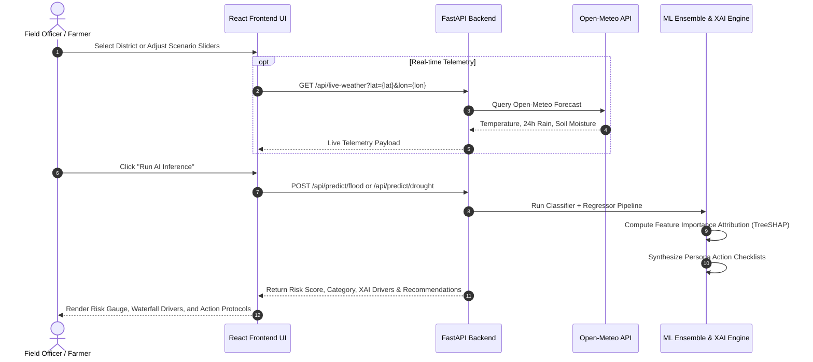

# AquaSentinel AI 🌊☀️
### AI-Powered Flood & Drought Early Warning and Climate Resilience Platform
**Hackathon Submission:** Green Planet — GP-03: Flood & Drought Early Warning System  
**System Designation:** Climate Resilience & Decision-Support Early Warning Platform  
**Target Users:** Farmers, Rural Communities, Disaster Management Authorities (DDMA/NDMA), Emergency Responders, Researchers

---

---

## ⚡ Quick Start: How to Run the Project

### Prerequisites
- **Python 3.10+** (https://www.python.org/)
- **Node.js 18+ & npm** (https://nodejs.org/)

---

### Option A: 1-Click Launch (Recommended for Windows)

Simply double-click:
`at
run_project.bat
`
*(Or in PowerShell: .\run_project.ps1 | macOS/Linux: ./run_project.sh)*

This script automatically launches both the **FastAPI Backend (port 8000)** and the **React Vite Frontend (port 5173)** in separate windows.

---

### Option B: Manual Step-by-Step Launch

#### 1. Start the Backend
Open a terminal in the project root directory:

`ash
# Windows
python -m venv backend\.venv
backend\.venv\Scripts\activate
pip install -r requirements.txt
uvicorn backend.app.main:app --host 0.0.0.0 --port 8000 --reload
`

`ash
# macOS / Linux
python3 -m venv backend/.venv
source backend/.venv/bin/activate
pip install -r requirements.txt
uvicorn backend.app.main:app --host 0.0.0.0 --port 8000 --reload
`
*Backend Swagger API docs will be live at:* **http://localhost:8000/docs**

#### 2. Start the Frontend
Open a **second terminal** in the project root:

`ash
cd frontend
npm install
npm run dev
`
*Frontend Web Application will be live at:* **http://localhost:5173**

---

### 🔑 Pre-Seeded Demo Login Accounts

You can switch roles with 1 click in the top navbar or log in using:

| Role | Email | Password | Primary Purpose |
| :--- | :--- | :--- | :--- |
| **Citizen** | citizen@aquasentinel.org | citizen123 | 5-second risk check, safe evacuation guide, AI assistant |
| **Farmer** | armer@aquasentinel.org | armer123 | Soil moisture deficit, crop advisories, PMFBY insurance |
| **Disaster Official** | official@aquasentinel.org | official123 | Multi-hazard triage table, river gauges, alert broadcasts |
| **Administrator** | dmin@aquasentinel.org | dmin123 | User account administration, system diagnostic telemetry |

---

## 1. Executive Summary & Problem Statement

Floods and droughts represent two sides of the same accelerating climate volatility crisis. Globally and across India, agricultural belts and river basins frequently oscillate between devastating monsoon deluges and prolonged dry spells within the same agricultural calendar.

### Current Gaps in Traditional Disaster Warning Systems:
1. **Hazard Silos:** Flood forecasting is managed by river commissions, while agricultural drought monitoring is handled by separate agricultural ministries. There is no unified multi-hazard intelligence.
2. **Abstract Forecasts vs. Localized Impact:** Broad regional rainfall percentages fail to explain whether a specific polder, village bund, or catchment basin will overtop or wilt.
3. **Black-Box AI Skepticism:** Traditional neural network models provide numeric alert codes without answering: *"Why is this location at risk?"*
4. **Action Paralysis:** Warnings often lack non-generic, role-specific guidance tailored for farmers, residents, and district magistrates.

---

## 2. Proposed Solution: The AquaSentinel AI Platform

**AquaSentinel AI** is an intelligent early warning and decision-support web platform that unifies flood and drought monitoring under a single pane of glass. It bridges the gap between raw meteorological telemetry and life-saving community action.

```mermaid
flowchart TD
    subgraph Data Layer
        OM[Open-Meteo Live API - Global Weather & Soil Moisture]
        DEMO[Physics-Calibrated Benchmark Hydrometeorological Datasets]
        GEO[22+ Vulnerable Indian Districts Registry]
    end

    subgraph Backend - FastAPI & Python ML
        API[FastAPI Asynchronous Gateway]
        FP[Flood Random Forest Ensemble Predictor]
        DP[Drought Gradient Boosting Predictor]
        XAI[TreeSHAP & Gini Explainability Engine]
        REC[Persona-Specific Action Recommendation Engine]
        ALT[Alert Notification & Broadcast Hub]
    end

    subgraph Frontend - React TypeScript & Vite (Simplified Citizen-Centric UI)
        UI[Clean Public Interface: 5-Second Comprehension]
        MAP[India Flood & Drought Geospatial Maps]
        RIV[12-Station Indian River Gauge Monitor]
        CHK[3-Step Citizen Risk Check Tool]
        ALT[Emergency Alert Cards & Response Action]
        SAF[Student & Villager Safety Guides]
        HIST[12-Month Area Chart & Historical Case Studies]
        ABT[Explainable AI Engine & Judge Technical Inspection]
    end

    OM --> API
    DEMO --> FP & DP
    GEO --> API
    API --> FP & DP
    FP & DP --> XAI
    FP & DP --> REC
    REC --> UI
    XAI --> UI
    API --> UI & MAP & DASH & SIM & COMP & HIST
```

---

## 3. Key Innovations & Differentiators

1. **Unified Dual-Hazard Intelligence:** Seamlessly models both flood inundation and agricultural drought distress within one cohesive platform.
2. **Explainable AI (XAI) Attribution:** For every single prediction, AquaSentinel explains in plain English and quantitative feature weights: **"WHY IS THIS LOCATION AT RISK?"** (e.g. soil moisture saturation exceeding infiltration capacity vs. prolonged dry spells).
3. **Persona-Specific Action Engine:** Directs customized checklists for three key stakeholders:
   - **Farmers:** Micro-irrigation schedules, organic straw mulching, crop drainage clearance, PMFBY insurance triggers.
   - **Rural Residents:** 18-hour advance go-bag prep, safe water storage, culvert flash flood avoidance.
   - **Disaster Authorities (DDMA):** Motorized boat staging, barrage release coordination, drinking water tanker rosters.
4. **Google Maps Geospatial Risk Mapping:** Integrated Google Maps base layers (**Google Roadmap**, **Google Satellite Hybrid**, and **Google Terrain**) rendering 22+ high-vulnerability Indian districts with 5-tier color-coded severity polygons, 9 major river paths, water level gauges, and instant Google Earth inspection.
5. **Real-World Open-Meteo Live API Stream:** Allows live weather, precipitation, and soil moisture telemetry synchronization without requiring proprietary API keys.
6. **Multi-Channel Emergency Broadcast Simulator:** Previews alerts in Wireless Emergency Alert (WEA / CAP format), localized WhatsApp SMS, and Community Radio bulletins.

---

## 4. End-to-End Decision Workflow



---

## 5. Machine Learning Pipeline & Methodology

AquaSentinel implements separate, specialized machine learning pipelines for flood and drought hazards.

### Flood Risk Prediction
- **Algorithm:** Tuned `RandomForestClassifier` (with class-weighted penalty on false negatives) + Calibrated `RandomForestRegressor`.
- **Input Features:**
  - `rainfall_intensity`: Rainfall intensity rate in mm/h
  - `rainfall_24h`: Cumulative rainfall in last 24h in mm
  - `rainfall_7d`: Cumulative rainfall in last 7 days in mm
  - `river_water_level`: River water gauge height in meters
  - `soil_moisture`: Topsoil saturation percentage (0-100%)
  - `temperature`: Ambient temperature in °C
  - `elevation`: Terrain elevation in meters above sea level
  - `drainage_condition`: Drainage condition (0=Poor, 1=Moderate, 2=Good)
  - `historical_flood_occurrence`: Decadal flood recurrence frequency
- **Validation Metrics (4,500 samples, 20% holdout):**
  - **Accuracy:** `96.11%`
  - **Recall (Sensitivity):** `89.75%`
  - **ROC-AUC:** `0.9926`
- **Disaster Rationale:** High recall is prioritized because failing to issue a flood evacuation alert carries catastrophic human and economic costs.

### Drought Risk Prediction
- **Algorithm:** `GradientBoostingClassifier` + `RandomForestRegressor`
- **Input Features:**
  - `rainfall_deficit`: Seasonal precipitation deficit percentage below normal (0-100%)
  - `temperature`: Ambient temperature in °C (evapotranspiration driver)
  - `soil_moisture`: Soil moisture percentage (permanent wilting point proxy)
  - `relative_humidity`: Atmospheric humidity percentage
  - `vegetation_condition`: Satellite Vegetation Condition Index (VCI / NDVI-proxy 0-100%)
  - `historical_rainfall`: Long-term seasonal normal precipitation in mm
  - `consecutive_dry_days`: Number of continuous rainless days
- **Validation Metrics (4,500 samples, 20% holdout):**
  - **Accuracy:** `97.56%`
  - **Precision:** `95.80%`
  - **ROC-AUC:** `0.9960`
- **Disaster Rationale:** High precision prevents false drought declarations from prematurely exhausting State Disaster Response Funds (SDRF).

---

## 6. Monitored Indian Geographic Coverage

AquaSentinel AI comes pre-calibrated with 22 high-vulnerability hotspots across India:

| Category | Key Districts Monitored | River Basins & Terrains |
| :--- | :--- | :--- |
| **Flood Hotspots** | Dhemaji (Assam), Cachar/Silchar (Assam), Darbhanga (Bihar), Patna (Bihar), Wayanad (Kerala), Alappuzha/Kuttanad (Kerala), Kolhapur (Maharashtra), Mumbai Suburban (Maharashtra), Puri (Odisha), Gorakhpur (UP), Murshidabad (WB) | Brahmaputra, Barak, Kosi, Ganga, Kabini, Vembanad, Panchganga, Mithi, Mahanadi, Rapti |
| **Drought Hotspots** | Barmer (Rajasthan), Jaisalmer (Rajasthan), Latur (Maharashtra), Dharashiv (Maharashtra), Anantapur (AP), Kalaburagi (Karnataka), Kolar (Karnataka), Banda (UP), Tikamgarh (MP), Ramanathapuram (TN), Kutch (Gujarat) | Thar Desert, Marathwada, Rayalaseema, North Interior Karnataka, Bundelkhand, Rann of Kutch |

---

## 7. Technology Stack

- **Backend:** Python 3.10, FastAPI, Pydantic v2, Uvicorn, Scikit-learn, Pandas, NumPy, Joblib, HTTPX, Pytest
- **Frontend:** React 18, TypeScript, Vite, Tailwind CSS, Leaflet, React-Leaflet, Recharts, Lucide Icons
- **External APIs:** Open-Meteo Global Meteorological & Flood Forecast API (Free, keyless)
- **Deployment:** Render (Python Backend) + Vercel (React Frontend)

---

## 8. API Specification

| Method | Endpoint | Description |
| :--- | :--- | :--- |
| `GET` | `/api/health` | System health, model readiness, and monitored location tally |
| `GET` | `/api/dashboard` | National KPI averages, threat distributions, and immediate attention hotspots |
| `POST` | `/api/auth/register` | Registers a new user with PBKDF2-HMAC-SHA256 password security |
| `POST` | `/api/auth/login` | Authenticates user credentials and issues secure signed JWT token |
| `GET` | `/api/auth/me` | Validates session token and returns active user role and profile |
| `GET` | `/api/admin/users` | Lists all registered users and roles (restricted to Administrator) |
| `GET` | `/api/admin/system-status` | Operational telemetry and diagnostic metrics for system supervisor |
| `GET` | `/api/map/flood` | Authentic GeoJSON district polygons styled with 5-tier flood severity |
| `GET` | `/api/map/drought` | Authentic GeoJSON district polygons styled with drought severity scale |
| `GET` | `/api/map/rivers-geojson` | LineString geometries for 9 major Indian rivers (Ganga, Brahmaputra, etc.) |
| `GET` | `/api/map/combined` | Multi-hazard combined risk GeoJSON FeatureCollection |
| `POST` | `/api/chat` | Aqua AI Conversational Assistant (Gemini / OpenAI API + offline safety engine) |
| `GET` | `/api/safety-guide` | Procedural step-by-step checklists for Before, During, and After disaster |
| `GET` | `/api/location-risk` | Instant 5-second risk summary and 4 immediate actions for any district |
| `GET` | `/api/rivers` | Real-time gauge telemetry for 12 major Indian river monitoring stations |
| `POST` | `/api/predict/flood` | Executes Flood ML inference, generates XAI attribution & action plans |
| `POST` | `/api/predict/drought` | Executes Drought ML inference, generates XAI attribution & crop advisories |
| `GET` | `/api/locations` | Registry of 22 Indian districts with coordinates & vulnerability profiles |
| `GET` | `/api/risk-map` | Geospatial markers and color-coded polygon layers for Leaflet map |
| `GET` | `/api/alerts` | Active and acknowledged disaster early warning broadcasts |
| `POST` | `/api/alerts/generate` | Generates a new simulated emergency broadcast |
| `POST` | `/api/alerts/{id}/acknowledge` | Acknowledges an alert with responder verification |
| `GET` | `/api/history` | 12-month hindcast progression and extreme event case studies |
| `GET` | `/api/compare` | Side-by-side comparative vulnerability metrics between two districts |
| `GET` | `/api/live-weather` | Open-Meteo live proxy fetching precipitation, temperature, and soil moisture |
| `GET` | `/api/model-metadata` | Training metrics, confusion matrices, and ROC-AUC scores |

---

## 9. Pre-Seeded Demonstration Accounts

For rapid hackathon judging and evaluation, 4 pre-calibrated role accounts are embedded into the system. You can switch between them with **1 click** in the top navigation bar or log in directly:

| Role | Email | Password | Primary Purpose |
| :--- | :--- | :--- | :--- |
| **Citizen** | `citizen@aquasentinel.org` | `citizen123` | Public 5-second risk summary, emergency kit checklist, Aqua AI assistant |
| **Farmer** | `farmer@aquasentinel.org` | `farmer123` | Soil moisture deficit, micro-irrigation advice, PMFBY insurance triggers |
| **Disaster Official** | `official@aquasentinel.org` | `official123` | Regional triage table, CWC river gauge thresholds, alert broadcast & acknowledgment |
| **Administrator** | `admin@aquasentinel.org` | `admin123` | User account management console, system telemetry & diagnostic monitoring |

---

## 10. Local Installation & Setup

### Prerequisites
- Node.js (v18+) & npm
- Python (v3.10+)

### 1. Clone the Repository
```bash
git clone https://github.com/your-username/aquasentinel-ai.git
cd aquasentinel-ai
```

### 2. Backend Setup
```bash
# Create virtual environment
python -m venv backend/.venv

# Activate virtual environment
# Windows:
backend\.venv\Scripts\activate
# Linux / macOS:
source backend/.venv/bin/activate

# Install dependencies
pip install -r requirements.txt

# Train models & generate benchmark datasets
python -m backend.app.ml.train_models

# Run backend test suite (11 unit & integration tests)
pytest backend/tests -v

# Start FastAPI backend server
uvicorn backend.app.main:app --host 0.0.0.0 --port 8000 --reload
```
*Backend API docs will be live at `http://localhost:8000/docs`.*

### 3. Frontend Setup
```bash
# In a new terminal:
cd frontend

# Install dependencies
npm install

# Start Vite development server
npm run dev
```
*Frontend will be running at `http://localhost:5173`.*

---

## 10. Deployment Guide

### Deploy Backend on Render
1. Create a new **Web Service** on [Render.com](https://render.com).
2. Connect your GitHub repository.
3. Set **Root Directory** to `.` or `backend`.
4. Build Command: `pip install -r requirements.txt && python -m backend.app.ml.train_models`
5. Start Command: `uvicorn backend.app.main:app --host 0.0.0.0 --port $PORT`
6. Set Environment Variables: `ENVIRONMENT=production`.

### Deploy Frontend on Vercel
1. Import the repository on [Vercel](https://vercel.com).
2. Set **Root Directory** to `frontend`.
3. Set **Framework Preset** to `Vite`.
4. Environment Variables:
   - `VITE_API_BASE_URL`: `https://your-render-backend.onrender.com/api`
5. Click **Deploy**.

---

## 11. Limitations & Future Scope

### Limitations
- **Ground Telemetry Resolution:** The system currently relies on macro-scale Open-Meteo gridded forecast data and physical simulation benchmarks. Micro-watershed predictions require dense ground telemetry arrays.
- **Topographical Infiltration:** Extreme karst terrains or subterranean aquifers require specialized geotechnical boundary parameters.

### Future Scope
- **IoT River Gauge Mesh:** Integration with low-cost LoRaWAN ultrasonic river level sensors deployed at village bridges.
- **Satellite SAR Flood Extent:** Automated ingestion of Sentinel-1 Synthetic Aperture Radar (SAR) imagery for cloud-penetrating water masking.
- **Multilingual IVR & Audio Alerts:** Voice alerts in Hindi, Assamese, Bengali, Marathi, and Telugu delivered over feature phones for rural communities with low literacy.

---

## 12. Responsible AI & Ethical Disclosure

- **Transparent Data Governance:** This project does not fabricate data or pretend synthetic benchmarks are ground telemetry. Benchmark training sets are generated from peer-reviewed Soil Conservation Service (SCS) and Thornthwaite formulas and are explicitly labeled as demonstration datasets.
- **Advisory Scope:** AquaSentinel AI is an algorithmic decision-support tool. It does not replace official statutory evacuation commands issued by the National Disaster Management Authority (NDMA), Central Water Commission (CWC), or District Collectors.
- **AI Coding Tools Used:** Antigravity (Google DeepMind Advanced Agentic Coding) was utilized during system architecture, algorithmic formulation, and code generation.

---
## project run procedure Screenshots


## PROJECT SCREENSHOTS


## 13. License

Distributed under the MIT License. See `LICENSE` for more information.

